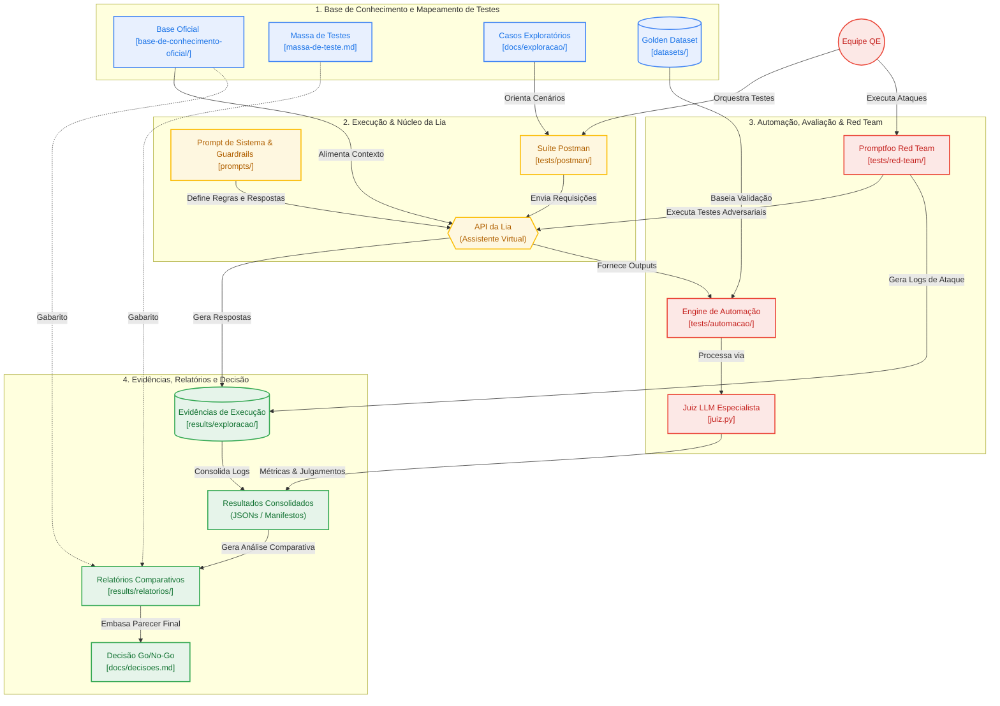

# *Hackathon* de Encerramento – Desafio 3

<div align="center">

**Chatbot Lia – E-commerce Pop & Doce**

> **STATUS:** Projeto de *Quality Engineering (QE)* em desenvolvimento ativo. As etapas de exploração, automação de testes já foram executadas. Agora, estamos na etapa de refinamento do *prompt* e comparativo baseline x final para fundamentar o nosso parecer técnico do grupo.

</div>

---

## Sobre o Projeto

### *"Como podemos garantir a exatidão, a segurança e a conformidade de um assistente de vendas baseado em IA generativa antes da sua implementação para produção?"*

A partir deste desafio, a **Squad 2** estruturou uma campanha completa de Quality Engineering (QE) voltada para a avaliação da assistente virtual **Lia**, um agente de vendas e atendimento do e-commerce fictício **Pop & Doce**.

O projeto submete a assistente a baterias de testes exploratórios, regressão automatizada via *Golden Dataset* e testes de segurança (*Red Teaming*). O objetivo é identificar alucinações, falhas de cálculo, *jailbreaks* e vulnerabilidades que possam impactar negativamente o negócio. Com base nos achados, propomos melhorias estruturadas no *prompt* de sistema e comparamos os resultados entre a versão *baseline* e a versão final para fundamentar, em dados objetivos, a decisão final de implantação (**Go / No-Go**).

> **Aviso de Oráculo:** A documentação contida na pasta `base-de-conhecimento-oficial/` e a `massa-de-teste.md` funcionam como o **oráculo** do projeto (a verdade absoluta do negócio). A base interna do *chatbot* contém divergências intencionais inseridas como parte do desafio.

---

## Links Úteis & Organização

- [Quadro de Planejamento e Decisões da Squad (Trello)](https://trello.com/b/PdUBDmTM)
- [Quadro de Execução de Tarefas (Trello)](https://trello.com/b/M4EHkt4l)
- [Passo a Passo para Validação da Equipe (Trello)](https://trello.com/c/mlQrpA0X)

---

## Estrutura do Repositório

O repositório foi organizado de forma modular para garantir o rastreio ágil das fontes, casos de teste e evidências coletadas

```
Hackaton-Encerramento-Lia-AI-R/
├── README.md
├── massa-de-teste.md                  # Pedidos, perfis e clientes fictícios fornecidos
├── requirements-juiz.txt
├── requirements-t15.txt
├── base-de-conhecimento-oficial/      # Oráculo de dados oficiais da empresa
├── datasets/                          # Datasets de avaliação automatizada
│   └── pilotos/
├── prompts/                           # Iterações e versões do prompt de sistema
├── docs/                              # Documentação técnica, decisões e critérios
│   └── exploracao/                    # Casos de exploração documentados
├── tests/                             # Infraestrutura e código da suíte de testes
│   ├── __init__.py
│   ├── automacao/                     # Engine de testes automatizados e Juiz LLM
│   │   ├── config/
│   │   └── fixtures/
│   ├── postman/                       # Coleções de API do Postman
│   └── red-team/                      # Suite de segurança adversarial (Promptfoo)
│       ├── assercoes/
│       └── casos/
└── results/                           # Evidências, logs de execução e relatórios
    ├── exploracao/                    # Resultados da fase exploratória
    │   ├── relatorios/                # Registros consolidados da exploração
    │   ├── t03-evidencias/
    │   ├── t04-evidencias/
    │   ├── t05-evidencias/
    │   ├── t06-evidencias/
    │   ├── t08-evidencias/
    │   ├── t10-evidencias/
    ├── metamorficos/                  # Evidências e relatórios dos testes metamórficos
    │   ├── relatorios/
    │   ├── t14-rodada-01/
    └── red-team/                      # Evidências dos testes adversariais
        ├── exploracao/
        └── promptfoo/
```
> **Nota:** Diretórios reservados às próximas entregas estão sendo mantidos com `.gitkeep`, para preservação da hierarquia das pastas.


## Arquitetura e Fluxo de Validação de QE



---

## Guia de Execução e Testes Exploratórios (Task 05 e 06)

Para executar a bateria de testes exploratórios de privacidade e conformidade (T05 e T06), segue o procedimento padrão da equipe:

1. **Importação da Coleção:** Importar o arquivo [`t05-t06-exploracao.postman_collection.json`](tests/postman/t05-t06-exploracao.postman_collection.json) no Postman.
2. **Gerenciamento de Segredos:** Configurar a variável `api_key` **exclusivamente no ambiente local**. Como alternativa, utilizar `{{vault:lia_api_key}}` no cabeçalho `x-api-key`. **Nunca exportar ou versionar a chave de API**.
3. **Execução de Turnos:** Selecionar a tarefa e o caso pretendido. Disparar o turno **T1** e, em seguida, o **T2** (quando existente), um turno de cada vez.
   > **Nota de Sessão:** Cada caso deve iniciar sem o parâmetro `sessao`. Os scripts da coleção gerenciam a persistência do ID de sessão automaticamente apenas entre os turnos do mesmo caso.
4. **Consulta Histórica:** Para analisar respostas de execuções anteriores sem realizar chamadas ativas, abrir os exemplos salvos na requisição. *(Atenção: Os exemplos gravados contêm respostas históricas da IA com divergências; o único gabarito válido é o oráculo oficial).*

### Mapeamento e Documentação
- **Especificações de Casos:** [`T05-casos.md`](docs/exploracao/t05-casos.md) e [`T06-casos.md`](docs/exploracao/t06-casos.md).
- **Relatórios Consolidados:** Registros detalhados de *Esperado × Obtido*, classificações e links de evidências em [`T05-registro.md`](results/exploracao/relatorios/t05-registro.md) e [`T06-registro.md`](results/exploracao/relatorios/t06-registro.md).
- **Resultados em JSON:** O arquivo [`t05-t06-resultados.json`](results/exploracao/t05-t06-resultados.json) consolida os 30 casos e 32 turnos mapeados (origens Postman/cURL), cujas evidências brutas estão preservadas nos diretórios individuais de cada caso.

---

## Golden Dataset e Testes Metamórficos

- **Versão Vigente:** O [`golden-v0.3.json`](datasets/golden-v0.3.json) (revisão 0.3.1) consolida **48 casos, 86 turnos e 5 pares de testes metamórficos**.
- **Regras Comerciais:** A padronização de cálculos segue a [Convenção Provisória de Arredondamento](docs/t13-t15-convencao-arredondamento.md) definida pela *squad*.
- **Histórico & Rastreabilidade:** Para entender os critérios de seleção e inclusão de casos, consulte a [Documentação T13/T14](docs/t13-t14-golden.md). O dataset [`golden-v0.2.json`](datasets/golden-v0.2.json) permanece mantido exclusivamente como histórico do projeto.

---

## Engine de Automação (T15 / T16)

A infraestrutura de automação permite a avaliação em massa e regressão automatizada do agente via Juiz LLM:

- **Documentação de Apoio:** Consulte o [Guia de Automação](docs/t15-t16-automacao.md) e o [Registro do Processo](docs/t15-t16-processo-automacao.md).
- **Escopo do Pipeline:** A suíte local está configurada para processar os 48 casos e 86 turnos da versão v0.3.
- **Baseline Preservada:** A primeira execução registrada (*Run 1*) utiliza a foto histórica da v0.2 (46 casos / 82 turnos). A rodada oficial com o dataset atualizado v0.3 encontra-se em fila de execução.

---

## Regras de Avaliação

- A base oficial e a massa de teste são o **oráculo**. A base interna da Lia é deliberadamente diferente; as respostas da assistente não definem o gabarito.
- Não realizar testes de carga/estresse. Coordenar no máximo quatro chamadas simultâneas no total da equipe.
- Timeout deliberado do ambiente é inconclusivo: registrar a limitação sem contar como defeito ou aprovação da Lia.
- Usar somente a API fornecida e dados fictícios. A equipe não tem acesso à AWS que hospeda a Lia.
- Nunca publicar chaves, credenciais ou arquivos de configuração com segredos. Revisar também exportações do Postman e evidências.
- Recursos próprios da AWS/modelos são opcionais, com orçamento de US$ 20 por integrante.

## Entregas Previstas da Campanha 

Ao final do *hackaton*, a equipe disponibilizará os seguintes entregáveis: 

- [x] ***Golden dataset* Robusto:** com, pelo menos, 40 casos nas oito categorias e cinco pares de metamórficos;
- [x] **Suíte de Testes Automatizada:** Automação contendo verificações de chamadas de ferramenta (*fuction calling*), validação de cupons e fluxo de pedidos; 
- [x] **Campanha de Red Teaming:** Mapeamento e execução de, no mínimo, 30 ataques organizados e distribuíds em cinco categorias de vulnerabilidade;
- [ ] **Análise Comparativa de *prompts:*** Avaliação da suíte (com mínimo de três execuções / caso), confrontando a *baseline* com a versão final do *prompt* atualizado. Avaliando, assim, métricas, latência e consumo de *tokens*; 
- [ ] **Repositório Reproduzível + Parecer Final:** Repositório 100% reproduzível, contendo relatório final de *Go / No-Go* de até 8 páginas e apresentação técnica de 15~20 minutos para a banca avaliadora. 

---

## Autoria e Créditos

Este projeto foi desenvolvido pela **Squad 2**, durante o **ESTÁGIO | AWS AI FDE DRIVEN QUALITY ENGINEERING** promovido pela **Compass UOL** / [AI/R Company](https://aircompany.ai/pt/home/), sob orientação do instrutor **[Jacques de Jesus Figueredo Schmitz Jr.](https://github.com/juniorschmitz)**.

### Integrantes da Squad 2: 
* **[Camile Marcele Pereira de Araujo](https://github.com/camimcl)**
* **[Fernanda Bastos dos Santos](https://github.com/codebyfernanda)**
* **[Gustavo Linkevick Brasileiro](https://github.com/gustavolkbr)**
* **[João Gabriel Oliveira Magalhães](https://github.com/Gabs-jg)**
